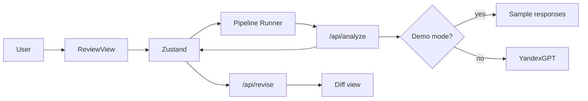

# AgentFlow

Multi-agent document approval system powered by YandexGPT. Upload a contract or specification — four AI experts (Lawyer, Finance, Security, PM) review it sequentially and produce a structured verdict.

## Demo

Deploy to Vercel **without API keys** — the app runs in demo mode with pre-generated responses.

With `YC_API_KEY` and `YC_FOLDER_ID` configured, the app uses real YandexGPT.

## Features

- Sequential 4-agent pipeline with individual prompts and context passing
- Structured output: approved / rejected / revision + comments and issues
- Document upload (.txt, .docx) or paste text
- Auto-generated corrected contract with before/after diff view
- Review history (localStorage)
- Export report as Markdown or PDF
- Demo fallback when Yandex Cloud credentials are missing

## Quick start

```bash
git clone <repo-url>
cd doc-ai-flow
npm install
cp .env.example .env.local   # optional — works without keys in demo mode
npm run dev
```

Open [http://localhost:3000](http://localhost:3000) and click **«Загрузить пример»**.

### Production (real YandexGPT)

1. [Yandex Cloud Console](https://console.cloud.yandex.ru) — create service account with role `ai.languageModels.user`
2. Create API key, copy folder ID
3. Add to `.env.local`:

```env
YC_API_KEY=your_api_key
YC_FOLDER_ID=your_folder_id
YANDEX_CLOUD_MODEL=yandexgpt-5.1/latest
```

## Tech stack

| Technology | Purpose |
|------------|---------|
| Next.js 14 (App Router) | Framework |
| TypeScript (strict) | Types |
| Tailwind CSS | UI |
| Zustand | State + persist |
| YandexGPT API | LLM |
| Vitest | Unit tests |

## Architecture



### Design decisions

1. **Sequential pipeline** — each agent sees previous experts' comments for coherent review
2. **JSON parser + retry** — structured LLM output with automatic retry on parse failure
3. **Patch-fallback for revise** — if full rewrite fails, model returns find/replace JSON patches applied locally

## API routes

| Route | Method | Description |
|-------|--------|-------------|
| `/api/analyze` | POST | Single agent analysis |
| `/api/revise` | POST | Generate corrected document |
| `/api/read-document` | POST | Parse uploaded .txt/.docx |
| `/api/demo-status` | GET | `{ demo: boolean }` |

## Project structure

```
app/
  api/                    # analyze, revise, read-document, demo-status
  page.tsx
components/
  review/                 # ReviewView (main screen)
  document/               # CorrectedDocumentModal, DocumentDiffView
  demo/                   # DemoBanner
  pipeline/               # AgentPipeline, PipelineSummary
lib/
  agents/                 # prompts, parser, patch revision
  demo/                   # sample contract, isDemoMode
  diff/                   # line diff
  yandex-gpt/             # API client
store/                    # Zustand stores
```

## Scripts

```bash
npm run dev        # development
npm run build      # production build
npm run test       # vitest
npm run ts:check   # typecheck
```

## Deploy on Vercel

1. Push to GitHub
2. Import in [Vercel](https://vercel.com)
3. **Demo only:** deploy without env vars
4. **Production:** add `YC_API_KEY`, `YC_FOLDER_ID`, optionally `YANDEX_CLOUD_MODEL`

## License

MIT
